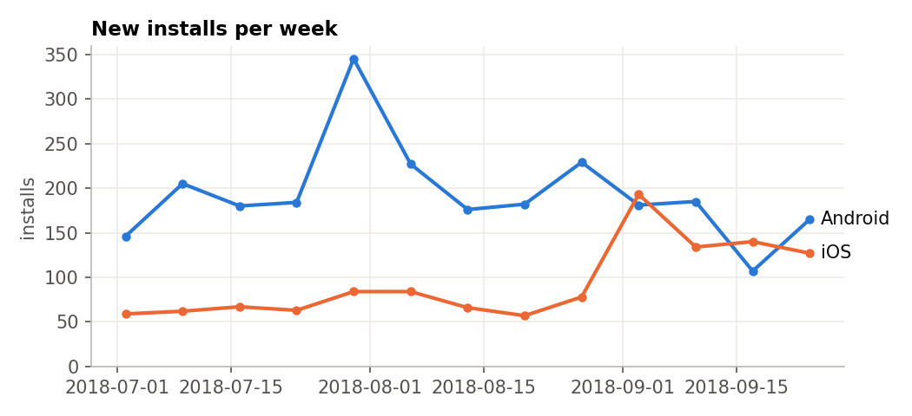
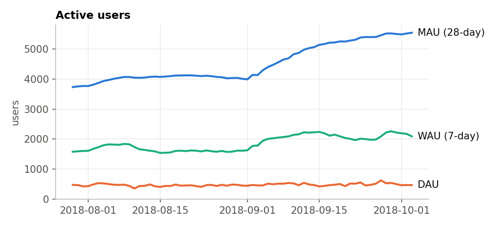
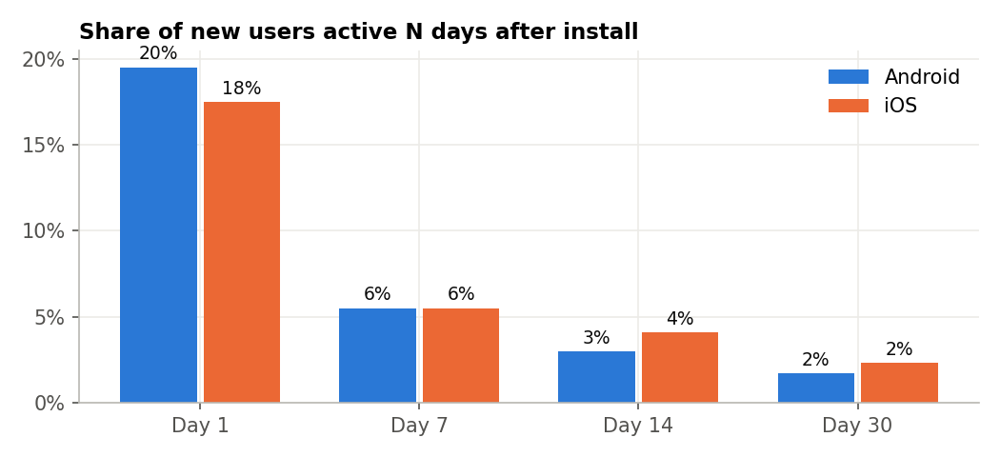
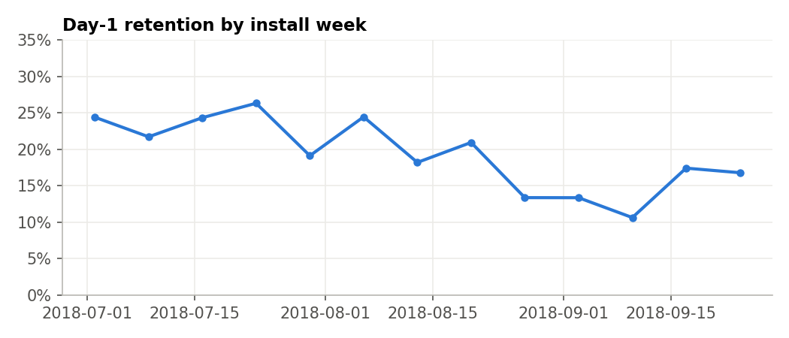
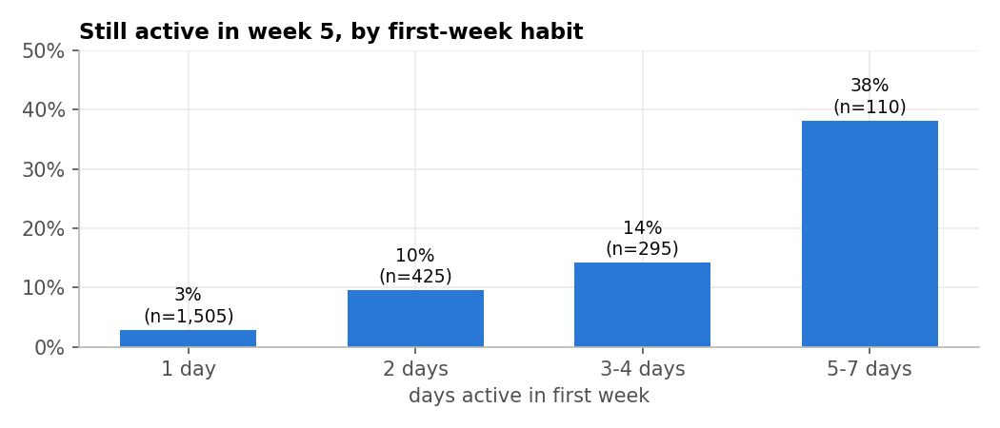
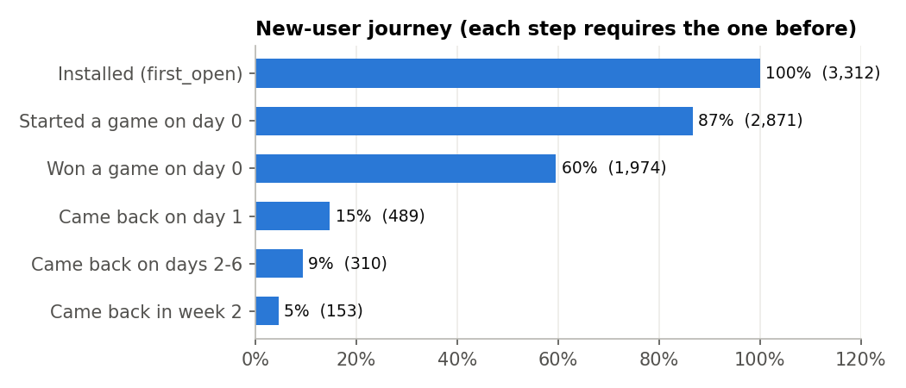
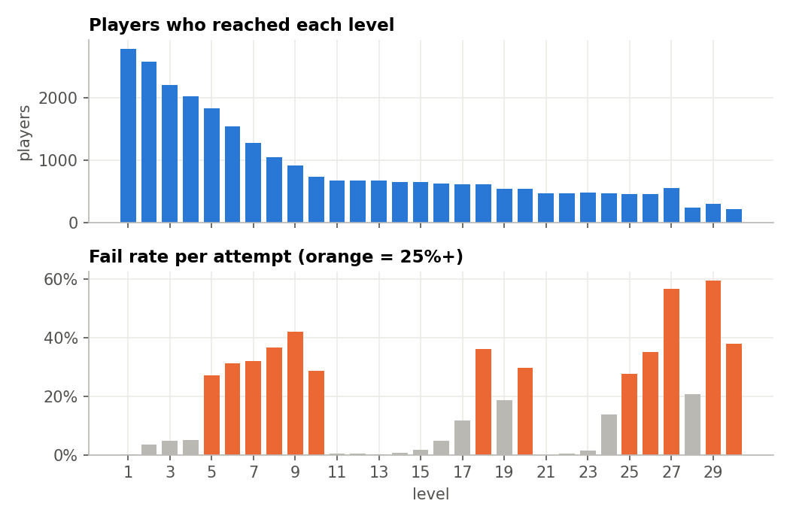
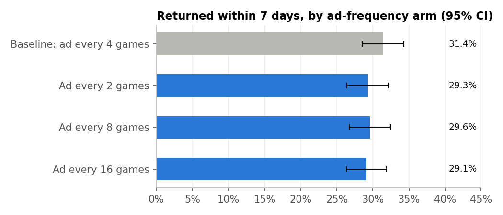

# Mobile App Performance Analysis: Firebase + BigQuery

**Business question:** *The app gets installs, so why isn't the user base growing, and what should marketing do about it?*

Analysis of real **Firebase Analytics** event data for a mobile app on iOS and Android. It covers downloads, acquisition, active users, retention, usage frequency, feature engagement, user journeys, points of disengagement, and a live Firebase A/B test.

- **Workflow:** raw Firebase events (BigQuery) → SQL per question → charts and stats (Python) → dashboard and recommendations memo.
- **Data:** Google's public Firebase export for *Flood-It!* (`firebase-public-project.analytics_153293282`): 5.7M events, 15K users. Analysis window: Jul 2 – Oct 3, 2018, with **3,894 new installs**.
- **Tools:** BigQuery SQL (GA4/Firebase nested schema), Python (pandas, SciPy, matplotlib).
- **Outputs:** [`dashboard.html`](dashboard.html) · [`memo.md`](memo.md) (one-page recommendations) · [`rehab_app_measurement_plan.md`](rehab_app_measurement_plan.md)

---

## Key findings

| # | Finding | Evidence |
|---|---|---|
| 1 | **Retention is the problem, not installs.** 60% of new users win a game on day 0, but only 19% return on day 1. | D1 19% · D7 5.5% · D30 1.8% |
| 2 | **First-week habit predicts long-term use.** Users active 5–7 days in week 1 are 13× more likely to still be active in week 5. | 38% vs 3% |
| 3 | **Levels 5–9 are a difficulty wall.** The fail rate jumps from 5% to 27–42%, and 63% of players are lost between level 4 and level 10. | 2,022 → 742 players |
| 4 | **Android users uninstall fast.** 30% uninstall on install day; 42% within 7 days. | Firebase `app_remove` |
| 5 | **Channel performance can't be measured.** 69% of installs have no source attached. | `traffic_source` |
| 6 | **Day-1 retention fell 9 points.** It dropped from 23% (July cohorts) to 14% (late Aug–Sep), with no app release that would explain it. | Cohort trend |
| 7 | **A/B test: ad frequency had no measurable effect** on 7-day return. Every arm is within 2.3 pts of baseline (p > 0.25), but the test could only detect changes of about 6 pts or more. | `firebase_exp_1` |

## Recommendations

| # | Action | Measure of success |
|---|---|---|
| 1 | Send a day-1 return prompt (a push or daily challenge 20–24 h after install), and A/B test it | D1 retention |
| 2 | Smooth the difficulty curve at levels 5–9 (add a hint or ease the difficulty) | Share of players reaching level 10, D7 |
| 3 | Fix attribution: UTM-tagged store links, Play install referrer, Google Ads ↔ Firebase linking | % of installs with a known source |
| 4 | Split the September cohorts by campaign to find the cause of the D1 drop | D1 by source |
| 5 | Keep ad frequency at baseline; rerun the test at about 4× the sample before adding more ads | 7-day return, minutes per user |

The full reasoning is in [`memo.md`](memo.md).

---

## 1. Downloads & acquisition · [`sql/01`](sql/01_acquisition.sql)



| Channel | Share of installs |
|---|---|
| Direct / unattributed | 68.7% |
| Google Play organic | 30.6% |
| Referral, web search, paid | < 1% |

iOS installs more than doubled in September; Android stayed flat.

## 2. Active users · [`sql/02`](sql/02_active_users.sql)



DAU averaged **475** and stayed flat while MAU grew to **5,546**. Stickiness (DAU/MAU) fell from 13% to 8%: the new users from September tried the app but did not keep using it.

## 3. Retention · [`sql/03`](sql/03_retention.sql)




Android and iOS retain about the same (D7 5.5% on both). For the D1 decline, I checked these causes in order:

1. **Data issue?** No. Event volume and DAU are steady across the period.
2. **App release?** No. Every cohort is on the same app version (Android 2.62, iOS 2.6.31).
3. **One platform?** No. Both Android and iOS cohorts dropped.
4. **Acquisition mix?** Likely. iOS installs doubled in September at the same time. Next step: split by campaign and source.

## 4. Usage frequency · [`sql/04`](sql/04_usage_frequency.sql)



65% of new users are active on only one day in their first week. Getting users to a **second active day** triples their week-5 rate (3% → 10%).

## 5. Feature engagement · [`sql/05`](sql/05_feature_engagement.sql)

| Feature (used on install day) | Adoption | Week-2 return if used | If not |
|---|---|---|---|
| Quick-play mode | 62% | 17.1% | 13.0% |
| Progressive mode | 48% | 17.1% | 14.1% |
| Extra-steps power-up | 20% | 18.1% | 14.9% |
| Completed 5 levels | 19% | **21.3%** | 14.2% |
| Rewarded ad | 2% | 22.8% | 15.4% |
| Challenge a friend | 2% | 18.5% | 15.5% |

Completing 5 levels on day 0 is the strongest early signal of retention (+7 pts). These are correlations, not proof of cause, so they are candidates for A/B tests.

## 6. User journey · [`sql/06`](sql/06_user_journey.sql)



The biggest drop is **day 0 → day 1**: of the 60% who win a game, only about 1 in 4 comes back the next day.

## 7. Points of disengagement · [`sql/07`](sql/07_disengagement_by_level.sql), [`sql/08`](sql/08_uninstall_timing.sql)



- Players drop steadily through **levels 5–9** while fail rates spike; after level 11 the player count stays flat.
- Level 27 has a 57% fail rate and is the last level for 221 lapsed users.
- Android uninstalls: **30% on day 0**, 5% on day 1, 8% on days 2–6.

## 8. A/B test: ad frequency · [`sql/09`](sql/09_ab_test_ad_frequency.sql), [`results/ab_test_stats.csv`](results/ab_test_stats.csv)

Firebase Remote Config experiment `firebase_exp_1`, with 4 arms and 3,947 users. Each arm maps to an `ad_frequency` value, which I verified in the data.



| Arm | Users | 7-day return | Diff vs baseline (95% CI) | p |
|---|---|---|---|---|
| Baseline: ad every 4 games | 996 | 31.4% | — | — |
| Ad every 2 games | 949 | 29.3% | −2.1 pts (−6.2, +2.0) | 0.31 |
| Ad every 8 games | 971 | 29.6% | −1.9 pts (−5.9, +2.2) | 0.37 |
| Ad every 16 games | 1,031 | 29.1% | −2.3 pts (−6.3, +1.7) | 0.25 |

- Sample ratio check passed (p = 0.29).
- No arm differs significantly. The minimum detectable effect at 80% power is **±5.8 pts**, so small effects can't be ruled out.
- Doubling ad frequency cut engagement by 2.9 min/user over 7 days (p = 0.17, not significant).
- **Decision:** keep the baseline. To test more ads, rerun with about 4× the sample.

---

## Data notes

- **Excluded June 12 – July 1.** Seven days in that period show about 2.7× the normal user count with zero installs, a quirk of Google's obfuscated sample. See [`sql/00`](sql/00_data_audit.sql).
- **"Active"** means a `user_engagement` event, the same definition Firebase uses.
- **`app_remove` is logged only on Android,** so the uninstall metrics are Android-only.
- **The `level` parameter is mostly empty,** so the level number is parsed from `level_name`.
- **Store data** (App Store Connect and Play Console impressions and page views) is not part of a Firebase export; installs are measured with `first_open`.

## Reproduce

```bash
pip install -r requirements.txt
gcloud auth application-default login
GCP_PROJECT=your-project-id python run_queries.py   # ~4 GB per query, inside the BigQuery free tier
python analysis.py && python build_dashboard.py
```
